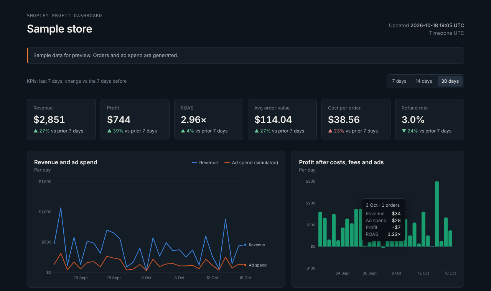
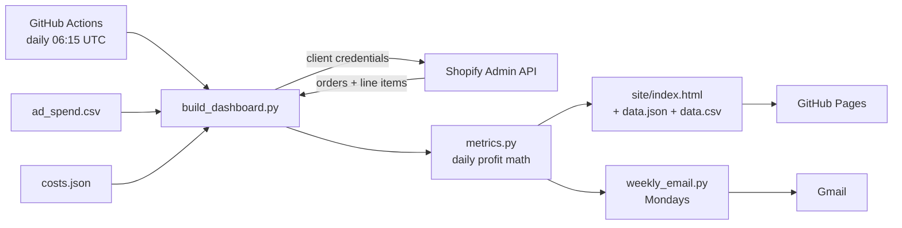
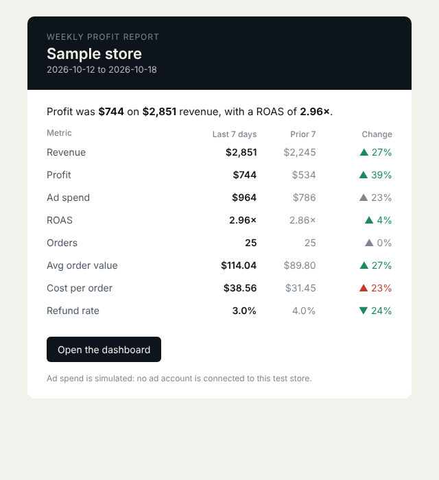

# Shopify Profit Dashboard

A daily dashboard that shows what a Shopify store actually earns after product costs, payment fees and ad spend. It rebuilds itself every morning from live store data, publishes to GitHub Pages, and emails a weekly summary every Monday.


**Live dashboard:** https://riadmrad1992-blip.github.io/shopify-profit-dashboard/

Project 2 of an e-commerce automation portfolio by **Riad Mrad**. Project 1: [Shopify Sales Alerts](https://github.com/riadmrad1992-blip/shopify-sales-alerts).



---

## What it shows

| Metric | How it's calculated |
|---|---|
| Revenue | Order totals, grouped by sale date in the store's timezone |
| Profit | Revenue − refunds − product costs − payment fees − ad spend |
| ROAS | Revenue ÷ ad spend |
| Avg order value | Revenue ÷ orders |
| Cost per order | Ad spend ÷ orders |
| Refund rate | Refunds ÷ revenue |

KPIs compare the last 7 days with the 7 days before. Period ratios are computed from period totals, never by averaging daily ratios. A daily table and a CSV download sit under the charts.

## How it works



1. **Fetch.** Orders for the last 30 days come from the Shopify Admin GraphQL API, including line items, so each order can be costed by product.
2. **Cost.** `costs.json` holds unit costs per product and the payment fee rate. Products without a listed cost are costed at a default percentage of order value.
3. **Ad spend.** `ad_spend.csv` takes daily spend exported from an ad platform (Meta, Google, TikTok). Days with no row use clearly labelled **simulated** spend, so the demo works on a test store with no ad account.
4. **Publish.** The page is static HTML with hand-drawn SVG charts and no front-end dependencies, deployed to GitHub Pages.
5. **Report.** On Mondays the same run emails a summary table with week-over-week changes and a link to the dashboard.



## Reliability

- **Tests run before every build.** If they fail, nothing is published and yesterday's dashboard stays live.
- **Failure alerts.** A failed run posts to Slack (reusing the project 1 webhook), so a stale dashboard never goes unnoticed.
- **No secrets in code.** Credentials live in GitHub Actions secrets or a local `.env` excluded by `.gitignore`.
- **No dependencies.** Python standard library only.

## Setup

1. **Shopify app** with the `read_orders` scope and Custom distribution on your store. Copy its Client ID and Secret.
2. **Repository secrets** (Settings → Secrets and variables → Actions):

   | Secret | Value |
   |---|---|
   | `SHOPIFY_STORE` | `your-store.myshopify.com` |
   | `SHOPIFY_CLIENT_ID` | App Client ID |
   | `SHOPIFY_CLIENT_SECRET` | App Client Secret |
   | `GMAIL_ADDRESS` | Sending Gmail address (optional, for the email) |
   | `GMAIL_APP_PASSWORD` | A Gmail app password (optional) |
   | `REPORT_TO` | Where the weekly email goes (optional) |
   | `SLACK_WEBHOOK_URL` | Slack webhook for failure alerts (optional) |

3. **GitHub Pages:** Settings → Pages → Source: **GitHub Actions**.
4. **Costs:** edit `costs.json` with your product costs and payment fee rate.
5. Run **Actions → Profit dashboard → Run workflow** once.

### Run locally

```bash
python build_dashboard.py --sample     # preview with generated data, no credentials needed
python build_dashboard.py              # live data (needs .env)
python weekly_email.py --preview       # writes email_preview.html
python -m unittest discover -s tests -v
```

## Project structure

```
build_dashboard.py           # fetch, compute, write site/
metrics.py                   # profit math (pure functions, fully tested)
shopify_client.py            # auth + paginated order fetch
weekly_email.py              # Monday summary email
dashboard_template.html      # the page (inline CSS/JS, SVG charts)
costs.json                   # unit costs and fee assumptions
ad_spend.csv                 # daily ad spend (export from your ad platform)
tests/test_metrics.py        # unit tests
.github/workflows/           # daily build + deploy, tests on push
```

## Possible next steps

- Pull ad spend directly from the Meta Marketing API instead of a CSV
- Read product costs from Shopify's inventory cost field
- Split new vs returning customers to report true CAC
